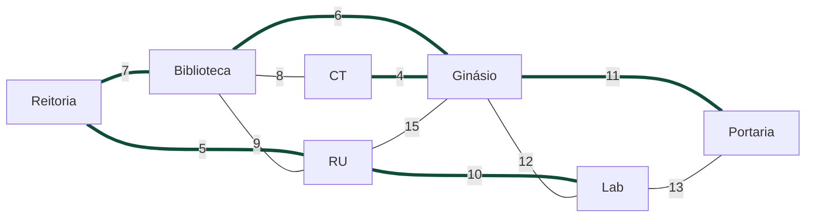

# Árvore Geradora Mínima: Kruskal e Prim

Explicação dos algoritmos de **Kruskal** e **Prim** com um exemplo em Python (`kruskal_prim.py`).
Material de apoio da disciplina de Programação Avançada (UFRN, 2026.2). O exemplo é independente de qualquer outro projeto.

```bash
python kruskal_prim.py   # Python 3.9+, só biblioteca padrão
```

---

## 1. O modelo: um grafo é uma rede de relações

Um grafo é uma estrutura matemática que representa objetos e as conexões entre eles. O contexto muda (cidades, computadores, prédios), mas a lógica de pontos e conexões permanece.

| Termo | Significado | Exemplo |
|---|---|---|
| **Vértice** (nó) | Os objetos da rede | cidades, computadores, prédios |
| **Aresta** | A ligação entre dois vértices | estradas, cabos |
| **Peso** | O valor de cada aresta | distância, tempo, custo |

## 2. O problema: conectar tudo pelo menor custo

Dado um grafo **conexo, não direcionado e com pesos**, queremos escolher arestas que:

1. **conectem todos os vértices**;
2. tenham a **menor soma de pesos possível**;
3. **não formem ciclos** (loops).

O resultado é a **Árvore Geradora Mínima (AGM)**, em inglês *Minimum Spanning Tree* (MST). Fatos úteis:

- Uma árvore geradora de um grafo com **V** vértices tem exatamente **V − 1** arestas.
- Se todos os pesos forem diferentes, a AGM é **única**. Com pesos repetidos pode haver mais de uma AGM, mas todas têm o mesmo custo.
- Se o grafo for **desconexo**, não existe árvore geradora (só uma floresta).
- Os dois algoritmos são **gulosos**: a cada passo escolhem a aresta mais barata que não estraga a solução. Isso funciona por causa da *propriedade do corte*: em qualquer divisão dos vértices em dois grupos, a aresta mais leve que cruza a divisão pertence a alguma AGM.

## 3. Kruskal: gulosa e global

O Kruskal olha para **todas as arestas** do grafo. Começa com uma floresta de vértices isolados, que vai se unindo aos poucos.

1. **Ordenar** todas as arestas, da mais barata à mais cara.
2. **Adicionar** as arestas uma a uma à árvore.
3. **Evitar ciclos**: ignorar a aresta que liga dois vértices que já estão no mesmo componente.

Para saber rapidamente se dois vértices já estão conectados, usa-se a estrutura **Union-Find** (conjuntos disjuntos): `find(v)` diz a qual componente o vértice pertence e `union(a, b)` junta dois componentes.

```text
KRUSKAL(V, E):
    A ← ∅
    para cada v em V: criar conjunto {v}
    ordenar E por peso crescente
    para cada (u, v) em E, nessa ordem:
        se find(u) ≠ find(v):         // componentes diferentes: não fecha ciclo
            A ← A ∪ {(u, v)}
            union(u, v)
    retornar A                        // pode parar ao chegar em V − 1 arestas
```

## 4. Prim: crescimento local contínuo

O Prim cresce **uma única árvore** a partir de um vértice inicial.

1. **Começar** por um vértice qualquer.
2. **Examinar a fronteira**: as arestas que ligam o grupo atual a vértices de fora.
3. **Expandir**: adicionar a de menor peso que alcance um vértice novo e repetir até cobrir todos.

Na implementação, a fronteira fica em uma **fila de prioridade** (heap), que entrega sempre a aresta mais leve.

```text
PRIM(V, E, início):
    T ← {início};  A ← ∅
    enquanto T ≠ V:
        escolher a aresta (u, v) de menor peso com u ∈ T e v ∉ T
        A ← A ∪ {(u, v)}
        T ← T ∪ {v}
    retornar A
```

## 5. Kruskal × Prim

| Critério | Kruskal | Prim |
|---|---|---|
| Estratégia | Gulosa, global | Gulosa, local |
| Foco | **Arestas** | **Vértices** |
| Crescimento | Une componentes dispersos (floresta → árvore) | Expande uma única árvore |
| Estrutura de apoio | Ordenação + Union-Find | Fila de prioridade (heap) |
| Complexidade | O(E log E) | O(E log V) com heap; O(V²) com matriz de adjacência |
| Melhor uso (regra prática) | Grafos **esparsos** | Grafos **densos** |

**Regra prática, não garantia de desempenho:** grafo esparso (poucas arestas) favorece o Kruskal e grafo denso (muitas arestas, perto de V²) favorece o Prim. A preferência também depende da representação do grafo e da implementação. Os dois sempre produzem uma AGM com o mesmo custo.

## 6. Exemplo: rede de fibra óptica de um campus

Queremos ligar 7 prédios com fibra óptica, gastando o mínimo. Cada aresta é um trajeto possível e o peso é o custo do cabo (valores **fictícios**, em R$ mil). `CT` = Centro de Tecnologia e `RU` = Restaurante Universitário.



*As arestas em verde grosso formam a AGM.* Ligar todos os trajetos custaria 100; a AGM custa **43**.

### Kruskal passo a passo

Arestas em ordem crescente de peso. O algoritmo para quando a árvore chega a V − 1 = 6 arestas, então as arestas de peso 12, 13 e 15 nem chegam a ser examinadas.

| # | Aresta | Peso | Decisão | Motivo |
|---|---|---|---|---|
| 1 | CT — Ginásio | 4 | aceita | une dois vértices isolados |
| 2 | Reitoria — RU | 5 | aceita | une dois vértices isolados |
| 3 | Biblioteca — Ginásio | 6 | aceita | Biblioteca entra no componente {CT, Ginásio} |
| 4 | Reitoria — Biblioteca | 7 | aceita | junta {Reitoria, RU} com {Biblioteca, CT, Ginásio} |
| 5 | Biblioteca — CT | 8 | **rejeitada** | os dois já estão no mesmo componente (ciclo) |
| 6 | Biblioteca — RU | 9 | **rejeitada** | os dois já estão no mesmo componente (ciclo) |
| 7 | RU — Lab | 10 | aceita | Lab entra na árvore |
| 8 | Ginásio — Portaria | 11 | aceita | Portaria entra; 6 arestas, fim |

### Prim passo a passo (começando por Reitoria)

| # | Fronteira (arestas que saem da árvore) | Escolhida | Peso |
|---|---|---|---|
| 1 | Reitoria—RU 5, Reitoria—Biblioteca 7 | **Reitoria — RU** | 5 |
| 2 | Reitoria—Biblioteca 7, RU—Biblioteca 9, RU—Lab 10, RU—Ginásio 15 | **Reitoria — Biblioteca** | 7 |
| 3 | Biblioteca—Ginásio 6, Biblioteca—CT 8, RU—Lab 10, RU—Ginásio 15 | **Biblioteca — Ginásio** | 6 |
| 4 | Ginásio—CT 4, Biblioteca—CT 8, RU—Lab 10, Ginásio—Portaria 11, Ginásio—Lab 12 | **Ginásio — CT** | 4 |
| 5 | RU—Lab 10, Ginásio—Portaria 11, Ginásio—Lab 12 | **RU — Lab** | 10 |
| 6 | Ginásio—Portaria 11, Lab—Portaria 13 | **Ginásio — Portaria** | 11 |

No código, a fronteira é um heap e algumas arestas ficam "velhas" (o vértice de destino já entrou na árvore por outro caminho). Elas são simplesmente descartadas ao serem retiradas do heap: é o que a saída mostra para Biblioteca—CT (8) e RU—Biblioteca (9).

### Resultado

Os dois algoritmos escolhem as mesmas 6 arestas, em ordens diferentes, com custo total **43**:

| Aresta | Peso |
|---|---|
| CT — Ginásio | 4 |
| Reitoria — RU | 5 |
| Biblioteca — Ginásio | 6 |
| Reitoria — Biblioteca | 7 |
| RU — Lab | 10 |
| Ginásio — Portaria | 11 |

<details>
<summary>Saída completa de <code>python kruskal_prim.py</code></summary>

```text
Grafo: 7 vértices, 11 arestas (custo de ligar tudo: 100).

=== Kruskal (arestas em ordem crescente de peso) ===
  + CT — Ginásio (4): aceita
  + Reitoria — RU (5): aceita
  + Biblioteca — Ginásio (6): aceita
  + Reitoria — Biblioteca (7): aceita
  x Biblioteca — CT (8): rejeitada (fecharia um ciclo)
  x Biblioteca — RU (9): rejeitada (fecharia um ciclo)
  + RU — Lab (10): aceita
  + Ginásio — Portaria (11): aceita

=== Prim (começando por Reitoria) ===
  + Reitoria — RU (5): aceita  | árvore: Reitoria, RU
  + Reitoria — Biblioteca (7): aceita  | árvore: Reitoria, RU, Biblioteca
  + Biblioteca — Ginásio (6): aceita  | árvore: Reitoria, RU, Biblioteca, Ginásio
  + Ginásio — CT (4): aceita  | árvore: Reitoria, RU, Biblioteca, Ginásio, CT
  - Biblioteca — CT (8): descartada (CT já está na árvore)
  - RU — Biblioteca (9): descartada (Biblioteca já está na árvore)
  + RU — Lab (10): aceita  | árvore: Reitoria, RU, Biblioteca, Ginásio, CT, Lab
  + Ginásio — Portaria (11): aceita  | árvore: Reitoria, RU, Biblioteca, Ginásio, CT, Lab, Portaria

AGM por Kruskal:
  CT — Ginásio: 4
  Reitoria — RU: 5
  Biblioteca — Ginásio: 6
  Reitoria — Biblioteca: 7
  RU — Lab: 10
  Ginásio — Portaria: 11
  Custo total: 43

AGM por Prim:
  Reitoria — RU: 5
  Reitoria — Biblioteca: 7
  Biblioteca — Ginásio: 6
  Ginásio — CT: 4
  RU — Lab: 10
  Ginásio — Portaria: 11
  Custo total: 43

OK: mesma árvore e mesmo custo (43); economia de 57 em relação a ligar tudo.
```

</details>

## 7. Estrutura do código

| Elemento | Papel |
|---|---|
| `UnionFind` | Conjuntos disjuntos com compressão de caminho e união por altura |
| `kruskal(vertices, arestas)` | Ordena as arestas e usa o Union-Find para evitar ciclos |
| `prim(vertices, arestas, inicio)` | Faz a árvore crescer com um heap (`heapq`) como fronteira |
| `lista_de_adjacencia(...)` | Converte a lista de arestas em vizinhos de cada vértice (usada pelo Prim) |
| `main()` | Roda os dois algoritmos no exemplo e confere que custo e arestas coincidem |

As funções devolvem `(arestas_da_AGM, custo_total)` e levantam `ValueError` se o grafo for desconexo. Para usar outro grafo, troque as listas `VERTICES` e `ARESTAS` no fim do arquivo.

## 8. Aplicações

- **Infraestrutura:** fibra óptica, tubulações de água e redes elétricas com custo mínimo.
- **Redes de computadores:** o *Spanning Tree Protocol* (STP) evita loops em switches. Ele também constrói uma árvore sem loops, mas **não equivale** a calcular uma AGM por Kruskal ou Prim.
- **Machine Learning:** *clustering* baseado em distância.

## Referências

- Material da disciplina: *Teoria dos Grafos e Árvores Geradoras Mínimas* (slides de Programação Avançada, UFRN).
- CORMEN, T. H. et al. *Introduction to Algorithms* (CLRS). Capítulo 23, *Minimum Spanning Trees*.
